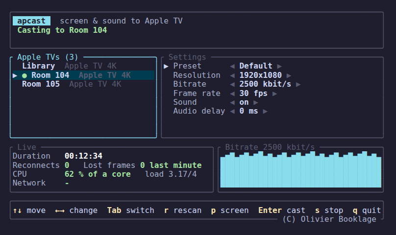

# apcast

> [!NOTE]
> Same family: [sccast](https://github.com/obook/sccast) for Chromecast,
> [sbcast](https://github.com/obook/sbcast) for interactive panels (screenshare).

`apcast` mirrors a Linux desktop's screen and sound to an Apple TV on the
local network.

Work in progress. `apcast list` finds the Apple TVs and `apcast info` shows
how each one is set (model, screen, password or PIN asked). Casting is not
written yet: a cast captures and encodes the screen, then drops the frames.
See [ROADMAP.md](ROADMAP.md).

## Requirements

- A Wayland session with `xdg-desktop-portal` (tested on KDE Plasma).
- PipeWire, with `pipewire-pulse` for sound.
- GStreamer (tested with 1.24).
- A Rust toolchain (`cargo`) 1.92 or newer, only to build from source.
- The PC and the Apple TV on the same local network, with mDNS (UDP 5353).

## Install

Download the `.deb` for your system from the
[latest release](https://github.com/obook/apcast/releases/latest):

- KDE neon: `apcast_<version>-1.neon_amd64.deb`
- Ubuntu 26.04: `apcast_<version>-1.ubuntu26.04_amd64.deb`

Then:

```sh
sudo apt install ./apcast_*_amd64.deb
```

## Build from source

Debian, Ubuntu and derivatives (tested on KDE neon 24.04):

```sh
sudo apt install pkg-config libgstreamer1.0-dev gstreamer1.0-tools \
  gstreamer1.0-plugins-{base,good,bad,ugly} gstreamer1.0-libav \
  gstreamer1.0-pipewire
```

Check the GStreamer elements, then build:

```sh
gst-inspect-1.0 pipewiresrc pulsesrc x264enc avenc_aac appsink > /dev/null
cargo build --release
```

The binary is `target/release/apcast`. `packaging/build-deb.sh neon` or
`packaging/build-deb.sh ubuntu26.04` builds a `.deb` in Docker.

## Usage

```sh
apcast                          # menu: receivers, presets and settings
apcast list                     # receivers on the network
apcast info --device "Room 104" # model, version, screen, password or PIN asked
apcast cast --device "Room 104" # name or id from `apcast list`
```



Each cast first opens the screen dialog. In a terminal, `apcast` alone, or
`apcast cast` without `--device`, opens a menu: the Apple TVs appear as they
answer, and the command line options prefill the settings. Arrows move and change, Tab
switches columns, Enter casts, `s` stops, `p` chooses another screen and
moves the running cast to it, `q` or Ctrl+C quits.

| Option | Default | Effect |
|---|---|---|
| `--resolution WxH` | `1920x1080` | Output size, letterboxed to keep the screen shape |
| `--fps N` | `30` | Frame rate |
| `--bitrate KBPS` | `2500` | Video bitrate in kbit/s |
| `--no-audio` | | Video only |
| `--audio-delay MS` | `0` | Delays the sound. The menu changes it during a cast |

## Troubleshooting

No receiver found: the PC may block mDNS (UDP 5353).

Logs: `RUST_LOG=apcast=debug apcast cast ...`. The menu always writes its
log to `$XDG_RUNTIME_DIR/apcast.log`, emptied at each start.

## Author

Olivier Booklage <olivier.booklage@ac-bordeaux.fr>

## License

MIT, see [LICENSE](LICENSE).

The Rust dependencies use MIT, Apache-2.0, ISC or BSD licenses. At run
time, `apcast` loads GStreamer (LGPL-2.1 or later) and its `x264enc`
plugin, which wraps x264 (GPL-2.0 or later).
